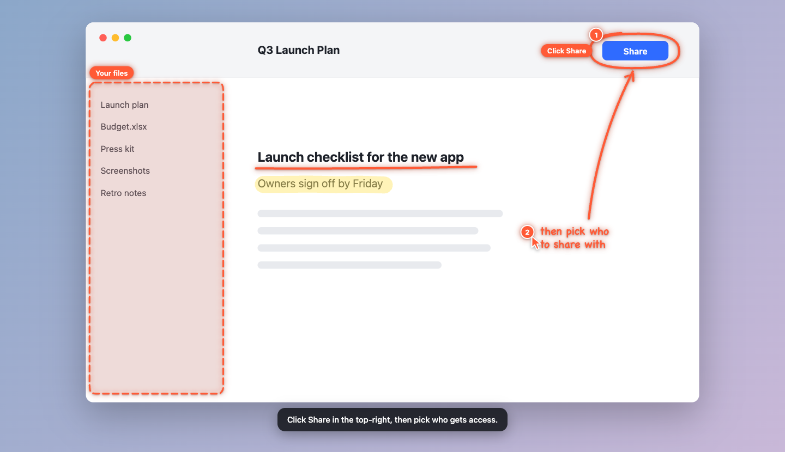

# screen-ink

screen-ink shows answers on your screen. It draws rings, arrows, notes and 3D models on top of your apps, and it
speaks the answer to you.



## What it does

- **Ask about your screen.** Press ⌥⇧Space and ask a question. screen-ink draws the answer on top of your apps.
- **Follow the steps.** For a task with many clicks, screen-ink shows one step at a time. It can also do the clicks
  for you.
- **See how things work.** Ask "How does a bicycle gear work?" screen-ink builds a 3D model that moves.
- **Build LEGO sets.** Ask "Help me build LEGO 60285." screen-ink shows each step and reads it to you.
- **Connect an agent.** Claude Code, Codex and other MCP agents can see your screen and draw on it.

## Requirements

- A Mac with macOS 13 or later. Windows and Linux are not tested.
- Node.js 22 or later.
- One of these to give the answers:
  - Claude Code, signed in (default)
  - An Anthropic API key
  - Codex, signed in
- Xcode command-line tools (recommended). With them, marks point at the correct button. To install them, run
  `xcode-select --install`.

## Install

1. Get the code and install the packages:

   ```bash
   git clone https://github.com/Syrul/screen-ink.git
   cd screen-ink
   npm ci
   ```

2. Start the app:

   ```bash
   npm start
   ```

3. Find ✎ in the menu bar. The Settings window opens the first time.
4. In Settings, give these permissions:
   - **Screen Recording**: to see your screen.
   - **Accessibility**: to find buttons and to click for you.
   - **Microphone**: to hear your questions.
5. Restart the app after you give Screen Recording.

> [!NOTE]
> When you run screen-ink from source, macOS shows these permissions for "Electron".

## Use

1. Press ⌥⇧Space.
2. Speak your question. Or type it and press ↵.
3. screen-ink draws the answer and speaks it.

| To do this | Do this |
| --- | --- |
| Ask a follow-up question | Press ⌥⇧Space again within two minutes. |
| Start a new conversation | Press ⌘N in the question bar. |
| Stop an answer | Press Esc. |
| Clear the screen | Press ⌃⌥Esc. |
| Change the model, voice, shortcut or ink color | Open **Settings** from the ✎ menu. |

## Connect Claude Code

Type these commands in Claude Code:

```
/plugin marketplace add Syrul/screen-ink
/plugin install screen-ink@screen-ink
```

Then ask Claude Code: "Look at my screen and show me where to change the font size."

To connect Codex or another agent, read [Connect an agent](docs/GUIDE.md#connect-an-agent).

## Privacy

- Speech and voice recognition run on your Mac. Your voice does not leave your Mac.
- Screenshots go only to the model that you select in Settings.
- The agent server accepts connections only from your Mac. Each connection must have a secret token.
- screen-ink does not collect usage data. It checks GitHub one time each day for a new version.

The first start downloads the voice models (approximately 400 MB).

## More information

- [Full guide](docs/GUIDE.md): all features, settings, tools and environment variables.
- [Contributing](CONTRIBUTING.md): how to build, test and send changes.
- [Security](SECURITY.md): how to report a security problem.

## License

screen-ink is free software under the [MIT License](LICENSE).
